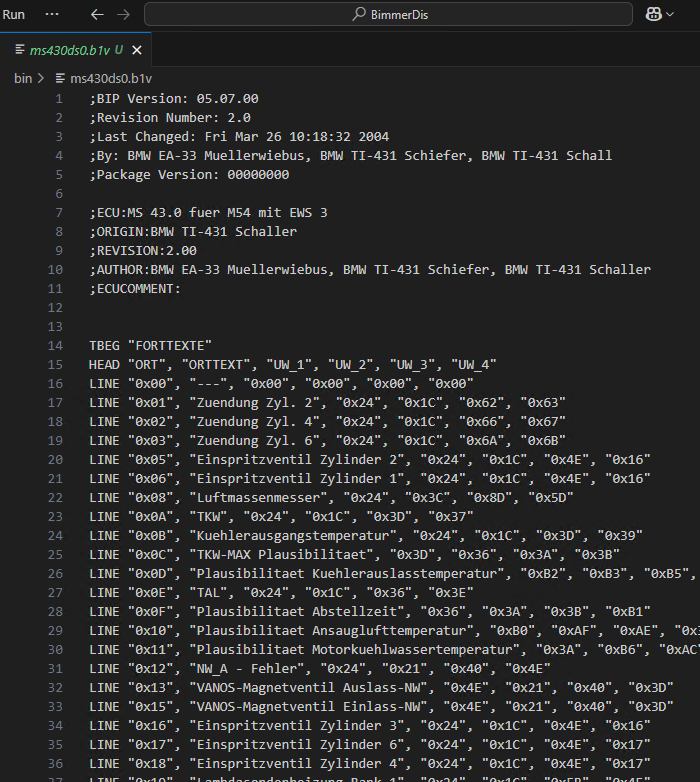
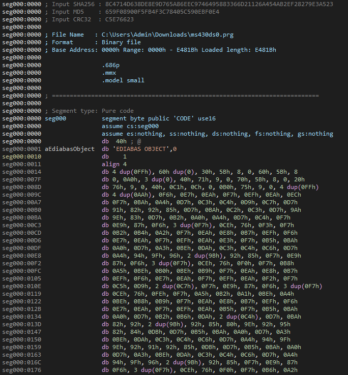

# BimmerDis

**BimmerDis** is a disassembler for BMW’s proprietary _"Beschreibungssprache für Steuergeräte"_ (**BEST**), which is used to define diagnostic routines for control units within the EDIABAS diagnostic system.

This tool is designed to interpret ECU description files — commonly distributed as PRG or GRP files.
BimmerDis decrypts these files by XOR‑ing each byte with 0xF7 and produces a human‑readable disassembly in a standardized output format (with a `.b1v` or `.b1g` extension).
This output provides detailed insight into the diagnostic jobs defined in the file, including sensor readings, error memory, and self‑tests.

## EDIABAS and PRG Files

**EDIABAS** (Electronic Diagnostic Basic System) is a diagnostic platform developed by Softing on behalf of BMW.
It uses the **BEST** language to create ECU description files that are distributed as **PRG** files.
These files (also known as **SGBD** - Steuergerätebeschreibungsdateien) contain not only the instructions for diagnostic routines but also hold important diagnostic telegrams, known as **DS2** (Diagnose System 2) messages.
DS2 messages are essential for reading live sensor data, error memory contents, and performing self‑tests on the vehicle’s control units.
BimmerDis automates the decryption and disassembly process, exposing both the ECU job definitions and the underlying DS2 diagnostic telegrams for further analysis.

## Features

- **Decryption:** Automatically decrypts binary BEST files by XOR‑ing every byte with 0xF7.
- **Disassembly:** Converts proprietary binary code into a human‑readable, assembly-like format.
- **Output Formats:** Generates output files with `.b1v` (or `.b1g` for group files) extensions that preserve the structure and details of the original ECU description.
- **Diagnostic Job Details:** Clearly lists job names, comments, and instruction sequences—including DS2 diagnostic telegrams—for in-depth analysis.
- **Integration:** Written in C++ for high performance and easy integration into diagnostic workflows.

## Usage

Run the executable from a command prompt (or terminal), passing the path to a BEST file (or its directory) as an argument:

```bash
BimmerDis.exe "C:\path\to\your\BESTfile.prg"
```

When executed, BimmerDis will:

1. Open the specified file.
2. Decrypt its content by XOR‑ing every byte with 0xF7.
3. Disassemble the decrypted binary into human‑readable instructions.
4. Save the output in the same directory as the input file with the appropriate extension (`.b1v` or `.b1g`).

## Screenshots

Below are two screenshots showing how a PRG (BEST) file appears before and after decryption/disassembly:

1. **Decrypted/Disassembled Output (`ms43ds0.b1v`):**

   

2. **Raw Binary Disassembly (`ms43ds0.prg`):**

   

These images illustrate the difference between the raw, partially x86-based disassembly (right image) and the final, more readable `.b1v` output (left image) produced by BimmerDis.

## Credits

BimmerDis builds on community efforts and is part of a larger collection of diagnostic tools.

For further details, additional tools, and background on the project, please refer to:  
[ediabaslib on GitHub](https://github.com/uholeschak/ediabaslib/tree/master/Tools/BESTDIS)